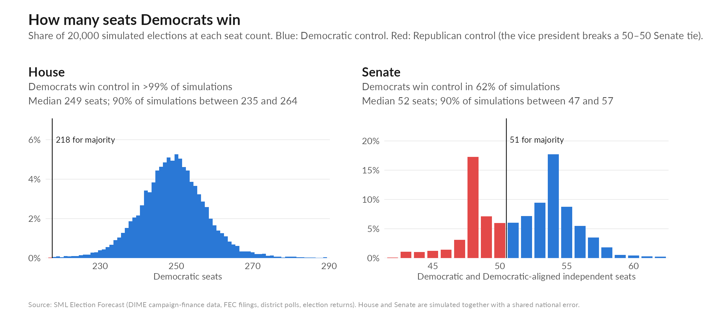
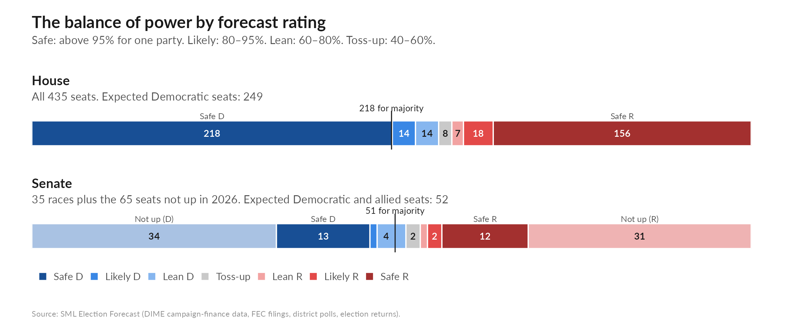
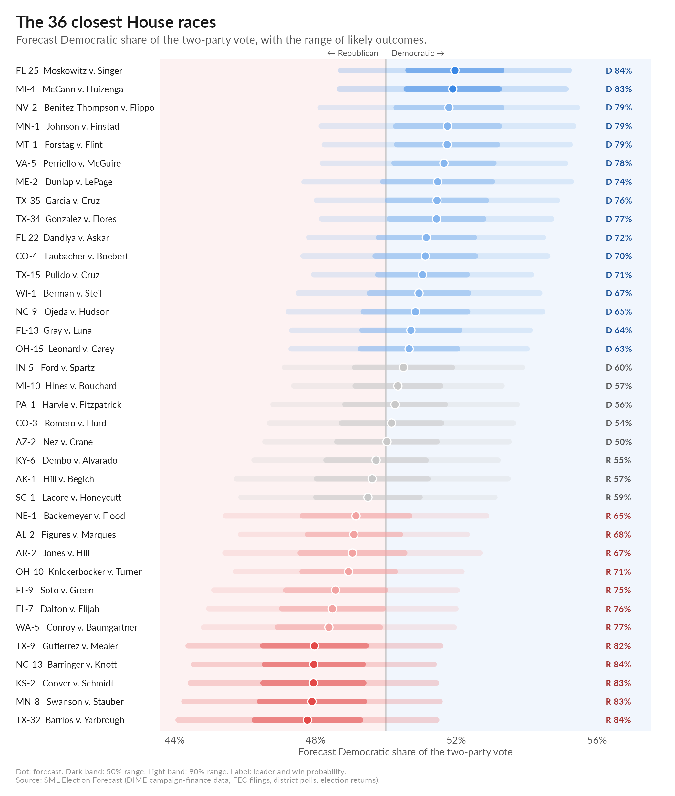
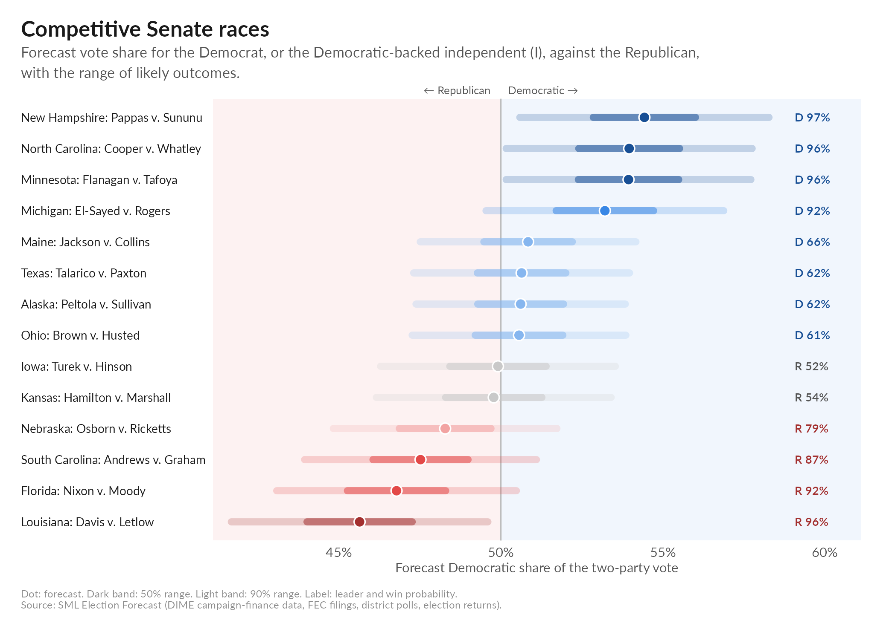
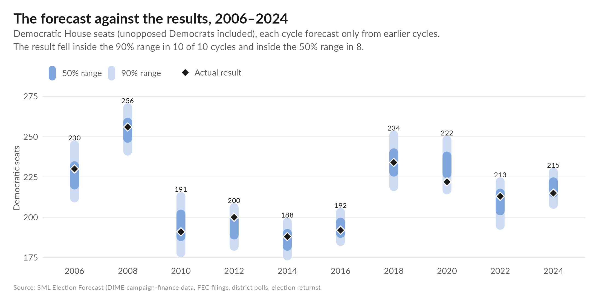
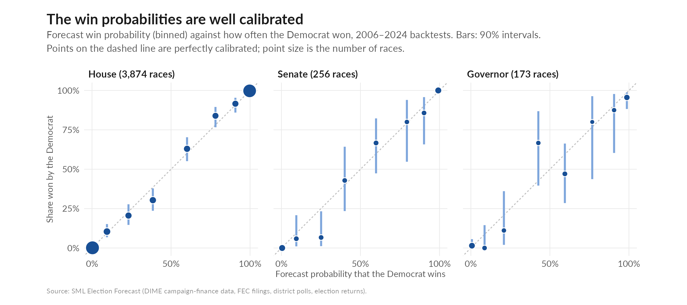

# SML Election Forecast 2026

A machine-learning forecast of the 2026 U.S. House, Senate, governor and state-legislative elections, built on campaign-finance
and donor data from the [Database on Ideology, Money in Politics, and Elections (DIME)](https://data.stanford.edu/dime) together with
district fundamentals and polls. Every contest gets a vote-share forecast and a win probability, and the offices are simulated
jointly. The model is backtested on every cycle from 2006 to 2024, each predicted only from earlier cycles.

## How it differs from a standard forecast

Most forecasts average the polls and blend that average with a fundamentals model. This one differs in five ways:

- **Money as signal.** Candidates' fundraising and spending, the size and makeup of their donor bases, and their ideology
  (CFscores from DIME, roll-call scores for incumbents) are core inputs.
- **Machine learning on what the fundamentals miss.** A simple national model sets each race's baseline from district
  partisanship, incumbency and the national environment. An ensemble of tree and linear models then learns where races depart
  from that baseline.
- **Polls as a feature.** In House races, a district poll is one input among many, weighed against money, candidates and expert
  ratings, not averaged into the forecast. Senate and governor forecasts blend polls with the fundamentals; in the Senate each
  added poll counts for less, so heavily polled races do not ignore the fundamentals.
- **Swing elasticity.** Competitive seats move more with the national environment than safe ones.
- **One national shock.** House, Senate and governor races share the same simulated national error, so the chambers move together.

## 2026 forecast

|Office               |Democratic seats (median) |90% interval |Probability                                     |
|:--------------------|:-------------------------|:------------|:-----------------------------------------------|
|U.S. House           |249                       |235–264      |Democratic majority: >99%                       |
|U.S. Senate          |52                        |47–57        |Democratic control (51+ with independents): 62% |
|Both chambers        |                          |             |Democrats win both: 62%                         |
|Governors (36 races) |21                        |16–27        |Democratic net gain (18 held now): 78%          |

### Senate races

|State |Democrat                   |Republican      |Forecast D share |P(Democrat wins) |
|:-----|:--------------------------|:---------------|:----------------|:----------------|
|MN    |Peggy Flanagan             |Michele Tafoya  |53.9             |96%              |
|NC    |Roy Cooper                 |Michael Whatley |54.0             |96%              |
|MI    |Abdul El-Sayed             |Mike Rogers     |53.2             |92%              |
|ME    |Troy Jackson               |Susan Collins   |50.8             |66%              |
|TX    |James Talarico             |Ken Paxton      |50.6             |62%              |
|AK    |Mary Peltola               |Dan S. Sullivan |50.6             |62%              |
|OH    |Sherrod Brown              |Jon Husted      |50.6             |61%              |
|IA    |Josh Turek                 |Ashley Hinson   |49.9             |48%              |
|KS    |Adam Hamilton              |Roger Marshall  |49.8             |46%              |
|NE    |Dan Osborn (I, Dem-backed) |Pete Ricketts   |48.3             |21%              |
|SC    |Annie Andrews              |Darline Graham  |47.5             |13%              |
|FL    |Angie Nixon                |Ashley Moody    |46.8             |8%               |
|LA    |Jamie Davis                |Julia Letlow    |45.6             |4%               |

### State legislatures

39 chambers are forecast. The competitive ones:

|Chamber   | D seats now|D median (90%) |P(D majority) |P(tie) |
|:---------|-----------:|:--------------|:-------------|:------|
|ME House  |          76|81 (69–94)     |79%           |       |
|PA House  |         102|105 (98–113)   |78%           |       |
|MI House  |          52|55 (46–64)     |43%           |8%     |
|NC House  |          49|54 (46–65)     |15%           |4%     |
|NC Senate |          20|22 (18–28)     |14%           |7%     |

## How well it does

Out-of-sample accuracy: each cycle is forecast from earlier cycles only, with the information available at the same point in the
campaign. 2024, the most recent cycle, is shown separately.

|Office   |Window          | Races| Contested|Correct winner |Vote-share error, contested (pts) | Wrong winner|Brier |
|:--------|:---------------|-----:|---------:|:--------------|:---------------------------------|------------:|:-----|
|House    |2018–22         |  1301|      1201|97.2%          |2.6                               |           37|0.020 |
|House    |2024 (hold-out) |   435|       397|98.2%          |2.1                               |            8|0.013 |
|House    |2006–24         |  4336|      3874|96.8%          |3.4                               |          140|0.024 |
|Senate   |2018–22         |   100|        95|93.0%          |2.9                               |            7|0.044 |
|Senate   |2024 (hold-out) |    33|        32|93.9%          |1.9                               |            2|0.035 |
|Senate   |2010–24         |   267|       256|93.3%          |3.1                               |           18|0.048 |
|Governor |2018–22         |    79|        79|93.7%          |3.6                               |            5|0.038 |
|Governor |2024 (hold-out) |    11|        11|90.9%          |5.4                               |            1|0.028 |
|Governor |2010–24         |   173|       173|87.9%          |4.3                               |           21|0.071 |

## Data and code

- `data/house.csv`, `senate.csv`, `governor.csv`, `stateleg.csv`: one row per contest (state legislatures: per seat-election),
  1996–2026, with candidate and contest information, the outcome, every model input, and the model's out-of-sample forecast.
  Variables are described in [`CODEBOOK.md`](CODEBOOK.md) (`data/codebook.csv`).
- `model/`: the production House, Senate and governor models (`forecast_v3.R`, `forecast_senate_v3.R`,
  `forecast_governor_v3.R`, `src/`) with every input they read. `bash model/run_model.sh` reruns the backtests (2002–2024,
  each cycle forecast from earlier cycles only) and the 2026 forecast into `model/output_v3/`, reproducing the published
  numbers exactly. About 15 minutes; requires R with `data.table`, `xgboost`, `ranger`, `glmnet` and `mgcv`. The training
  table is `model/data/cong_training_set_0930.rdata` (one row per contest; the donor-level contribution matrix is not included).

Sources: DIME and FEC filings (money and donors); MIT Election Lab, FEC and state results (outcomes); Voteview (roll-call
scores); Census ACS (demographics); district polls from the New York Times, FiveThirtyEight and Wikipedia; Cook Political
Report, Inside Elections and Sabato's Crystal Ball (expert ratings, used as an average).

**Caveats.** 2026 donor-profile features use contributions through July 29 for both parties (the Democratic donor file had not
been refreshed past that date). Hispanic-candidate indicators are inferred from surnames (Census surname file), not
self-identification. The Senate count includes the Democratic-backed independents (Osborn in Nebraska, and in Idaho, South Dakota
and Montana) with the Democrats.

## License

Code (`model/`) is released under the [MIT License](LICENSE). The data (`data/`) and figures are released under
[CC BY 4.0](https://creativecommons.org/licenses/by/4.0/): reuse freely with attribution. Underlying sources keep their own terms.

